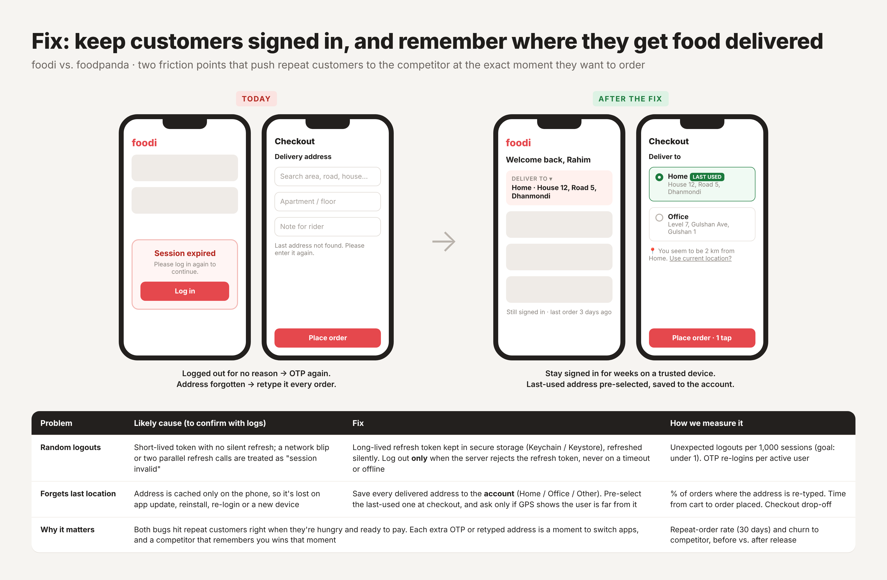

# foodi fix: stay signed in + remember the delivery address

Concept prototype for a Product Owner exercise. Unofficial, not affiliated with foodi. Demo data only.

## Problem
Repeat customers are lost to the competitor because the app:
1. Logs users out for no reason, so they must go through OTP again.
2. Forgets the last delivery address, so they retype it every order.

## Fix
- **Session:** a long-lived refresh token in secure storage (Keychain / Keystore) renews the session silently. The app logs out only when the server rejects the refresh token, never on a timeout or when offline.
- **Address:** every delivered address is saved to the account, not only the phone. The last-used address is pre-selected at checkout, and the app asks only when GPS shows the user is somewhere else.

## Try it
Open `index.html` in a browser (no build step). Switch between **Before** and **After**, then use the buttons to simulate a token expiring, a network drop, an app update, or the user being at the office.

## Success metrics
- Unexpected logouts per 1,000 sessions (goal: under 1)
- % of orders where the address is retyped
- Time from cart to order placed, checkout drop-off
- 30-day repeat-order rate and churn to competitor

## Deploy on GitHub Pages
Settings → Pages → Source: "Deploy from a branch" → branch `main`, folder `/ (root)` → Save.

